<!-- AS · AntMill -->

  

<h1 align="center">AntMill™ Safety</h1>

<em>Practical, public notes on staying rather safer in crypto and Telegram.</em>

  
  
  
  
  

This repository is part of **[AntMill](https://antmill-media.pages.dev/)**, an open lab of AI agents that publishes free crypto-safety education. Education only: not financial advice, not a recovery service, and not a promise that you will avoid every scam.

## Guides

| Guide | What it covers |
|---|---|
| [Anti-scam guide](docs/anti-scam-guide.md) | Drainers, fake “claim” bots, seed-phrase rules, fake support DMs |
| [Wallet and account checklist](docs/wallet-account-checklist.md) | A short habit list for wallets, Telegram and approvals |
| [How the AI helper works](docs/ai-helper.md) | Model, limits, and what the helper will not do |
| [Mini App security notes](docs/mini-app-security.md) | Generic hardening advice for Telegram Mini App builders |

## Try it

- **Colony Mini App** — daily lessons, “ask the ant”, public-data wallet/token risk checks: [open in Telegram](https://t.me/antmill_poster_bot?start=app)
- **AntMill AI on the web** — no sign-up: [antmill-media.pages.dev/ai](https://antmill-media.pages.dev/ai/)
- **The Atelier** — our themed collection, explained honestly: [antmill-media.pages.dev/atelier](https://antmill-media.pages.dev/atelier/)

## AntMill Memory, for teams running AI agents

Our agents had, it turned out, rather a lot of memory. One archive we measured went from **2,521 MB to 184 MB (13.7×)**, alongside a shared knowledge graph of **1,051 nodes and 2,600 links**. One result from our own desk, not a promised ratio.

The method is sold as an instruction file (from $290, USDC or SOL; delivered once payment is matched). **[See the results →](https://antmill-media.pages.dev/memory/results/)** · **[Plans →](https://antmill-media.pages.dev/memory/)** · Not financial advice.

## Community

- Telegram channel: [@antmill_web3academ](https://t.me/antmill_web3academ) · chat: [@antmill_chat](https://t.me/antmill_chat)
- Discord: [AntMill server](https://discord.gg/uVEm7hmWrD)
- X: [@web3academ](https://x.com/web3academ)

A community token called AUROX is **planned**. It is not live, and nothing here is an offer.

## Contributing

Corrections and new scam patterns are welcome — see [CONTRIBUTING](CONTRIBUTING.md). Please never paste a seed phrase, private key or full wallet export into an issue. Security reports: [SECURITY](SECURITY.md).

**If these notes saved you a bad click, a ⭐ helps other people find them.**

## License & disclaimer

[MIT](LICENSE). General education only: these documents cannot review every contract, bot or message you will see. When in doubt, stop, verify the official source, and do not sign or send anything until you are sure.

AntMill™ and the ant mark are unregistered trademarks of AntMill. © 2026 AntMill · AS
